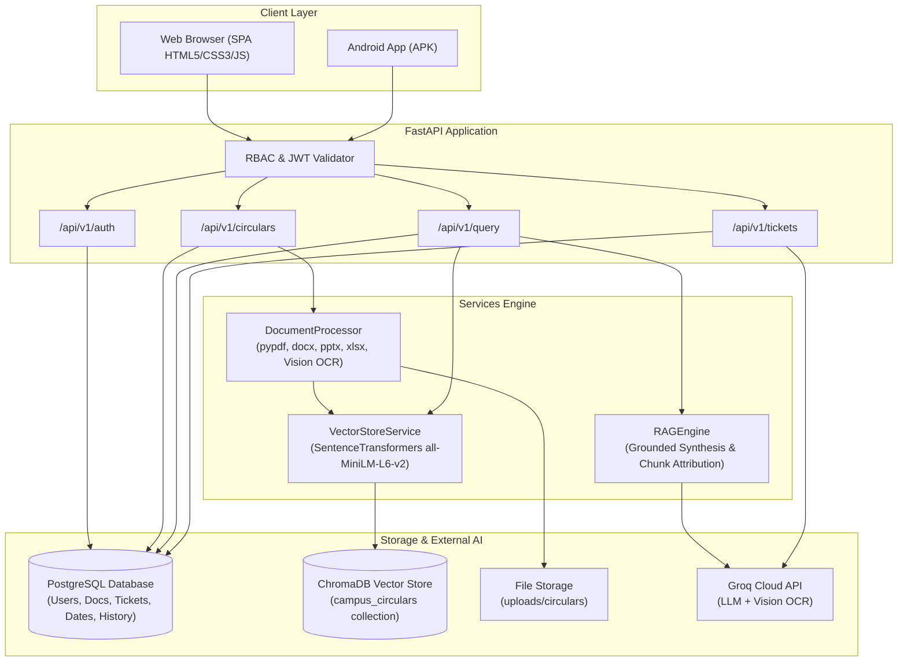

# **🌐 Live Demo deployed on AWS EC2: [https://analyzer-campus.duckdns.org/](https://analyzer-campus.duckdns.org/)**

---

# 🎓 Analyzer — Autonomous Campus Circular Query Engine & AI Help Desk

> **Srujan Hackathon 2026 Official Submission | Team SATS-X**  
> An intelligent, hallucination-shielded RAG query engine and closed-loop escalation desk for university circulars, exam seating, fee deadlines, and departmental policies.

---

## 📌 Table of Contents
1. [Overview](#-overview)
2. [Problem Statement](#-problem-statement)
3. [Key Highlights & Innovation](#-key-highlights--innovation)
4. [System Architecture](#-system-architecture)
5. [Core Features](#-core-features)
6. [Tech Stack](#-tech-stack)
7. [AI & RAG Pipeline Deep Dive](#-ai--rag-pipeline-deep-dive)
8. [Database & Security Design](#-database--security-design)
9. [API Reference](#-api-reference)
10. [Installation & Local Setup](#-installation--local-setup)
11. [Android Mobile App](#-android-mobile-app)
12. [Future Roadmap](#-future-roadmap)
13. [Team SATS-X](#-team-sats-x)
14. [Acknowledgments](#-acknowledgments)

---

## 📖 Overview

**Analyzer** is an authoritative, multi-modal campus intelligence platform designed to bridge the communication gap between university administration and students.

Instead of searching through endless WhatsApp groups, buried noticeboards, or multi-page PDFs, students can ask natural questions in plain English (e.g., *"When is the revaluation fee deadline?"* or *"Which room is allocated for my roll number in tomorrow's exam?"*) and receive immediate, factual answers backed by direct document citations.

For unanswered, ambiguous, or special grievance cases, Analyzer provides a **closed-loop escalation desk** that allows students to raise tickets directly to faculty, shielded by an automated **LLM semantic guardrail** that prevents spam, casual chit-chat, and academic dishonesty.

---

## 🎯 Problem Statement

1. **Information Fragmentation:** Critical notices (exam timetables, fee schedules, seating arrangements, hostel curfews) are published as scanned PDFs, spreadsheets, Word documents, or image banners across multiple unindexed channels.
2. **Hallucination Risk in Generic AI:** Standard LLMs invent dates, penalties, or roll number allocations when they don't know the exact campus rules.
3. **Faculty Overhead:** Academic coordinators and department desks spend hours answering the same repetitive queries or sorting through flooded email inboxes.
4. **Scanned & Tabular Document Blindspots:** Traditional search tools fail when documents are tabular spreadsheets (room seating ranges) or low-resolution scanned image PDFs.

---

## 💡 Key Highlights & Innovation

- 🛡️ **Zero-Hallucination Cosine Gating:** Strict calibrated cosine distance cutoff (`0.92`, boosted to `1.35` for schedule/exam queries). If no official circular matches the query, the LLM call is safely bypassed, shielding students from fabricated answers.
- 📑 **Universal Multi-Format Ingestion:** Native extraction for PDF, Microsoft Word (`.docx`), PowerPoint (`.pptx`), Excel (`.xlsx`, `.xls`), CSV, and raster images (`.png`, `.jpg`, `.jpeg`, `.webp`).
- 👁️ **Autonomous Groq Vision OCR Fallback:** Scanned PDF pages (< 30 characters detected) and image circulars are automatically rasterized via `pypdfium2` and transcribed into structured markdown tables using Groq Vision models.
- 🔢 **Numeric Roll Range & Seating Reasoning:** Dedicated prompt engineering evaluates numeric ranges (e.g., `start <= roll_no <= end`) to pinpoint exact room numbers, exam dates, and timings from tabular seating charts.
- 🎯 **Single Verified Citation Attribution:** The LLM explicitly signals the exact source chunk (`[USE_CHUNK: <index>]`), ensuring the student receives verifiable proof (file name, page number, category) for every answer.
- 🚦 **Groq LLM Escalation Guardrail:** Protects the Faculty Desk from off-topic chit-chat and academic malpractice (cheating, proxy attendance, leaks) via strict structured JSON classification before saving tickets.
- ⚡ **Sub-Second Response Latency:** Embedding models (`all-MiniLM-L6-v2`) and ChromaDB collections are preloaded at FastAPI server startup, eliminating request-time cold starts.

---

## 🏗️ System Architecture



---

## ✨ Core Features

### For Students
- **Natural Language Inquiry:** Instant query resolution across all active circulars with exact page/file citations.
- **Conversational Memory:** Automatic follow-up context stitching for short successive queries within a 10-minute window.
- **One-Click In-Browser Viewing:** Read source PDFs and files directly in the browser via authenticated stream endpoints.
- **Escalation Desk:** Unresolved queries can be forwarded to faculty with automated duplicate debounce locks and a 5 ticket/day limit.
- **Academic Deadlines Board:** Clean timeline of official campus key dates and milestones.
- **Dynamic FAQs:** Automatically surfaces common inquiries based on real-time aggregated student query frequency.
- **30-Day Chat Retention:** Chronological audit trail with one-click personal history clearance.

### For Faculty & Administrators
- **Faculty Administration Desk:** Drag-and-drop document upload supporting 10 file formats.
- **Instant Vector Ingestion:** Automatic text chunking, batch embedding (batch size = 32), and ChromaDB indexing.
- **Soft-Delete with Immediate Purge:** Deactivating a circular preserves audit records in SQL while immediately purging its embeddings from ChromaDB so it disappears from AI recall.
- **Ticket Triage Dashboard:** Filter tickets by status (`pending`, `resolved`, `rejected`), type official replies, and close inquiries.
- **Faculty Authorization Shield:** Faculty registration and login are protected by a secret authorization code configured by the deployment admin.

---

## 💻 Tech Stack

| Layer | Technologies Used |
| :--- | :--- |
| **Frontend** | Vanilla HTML5, CSS3, JavaScript (ES6+), Google Fonts, `qrcodejs` |
| **Backend** | Python 3.10+, FastAPI, Uvicorn, Pydantic v2 |
| **Database & ORM** | PostgreSQL (Neon Cloud / Local), SQLAlchemy 2.0, `psycopg2-binary` |
| **Authentication** | OAuth2 Password Bearer, JWT (HS256), `passlib[bcrypt]` |
| **Vector Database** | ChromaDB (`hnsw:space: cosine`, persistent storage) |
| **Embedding Model** | `sentence-transformers/all-MiniLM-L6-v2` (384-dimensional dense vectors) |
| **LLM & Vision Inference** | Groq Cloud API (LLM synthesis, guardrail classification, Vision OCR) |
| **Document Parsers** | `pypdf`, `pypdfium2`, `python-docx`, `python-pptx`, `openpyxl`, `xlrd`, `Pillow` |
| **Mobile App** | Android APK with dynamic origin detection |

---

## 🧠 AI & RAG Pipeline Deep Dive

### 1. Document Extraction & Chunking (`app/services/document_processor.py`)
- Standard text files are parsed natively.
- If a PDF page has < 30 characters (scanned image), `pypdfium2` renders a 300 DPI image in-memory and feeds it to Groq Vision OCR.
- Text is split into 800-character segments with 100-character overlap.
- Each chunk is permanently stamped with metadata:
  ```text
  [Document: <filename> | Category: <category> | Section/Page: <label>]
  ```

### 2. Embeddings & Preloading (`app/services/vector_service.py`)
- `SentenceTransformer('all-MiniLM-L6-v2')` and ChromaDB clients are initialized during FastAPI startup (`lifespan`), eliminating request-time cold starts.
- Embeddings are computed in batches of 32 for optimal CPU/GPU throughput.

### 3. Hallucination-Proof Retrieval & Gating (`app/api/v1/query.py`)
- Top candidate chunks are retrieved via cosine similarity.
- **Gating Metric:** Cosine Distance Cutoff = `0.92` (or `1.35` for schedule/exam queries with hybrid retrieval).
- If the best distance is above the cutoff, the query is marked `not_found` with `can_escalate=True`, completely skipping the LLM to prevent hallucinations.

### 4. Grounded Synthesis & Single Citation (`app/services/rag_engine.py`)
- The LLM is instructed under strict system constraints: bold critical details, cite facts solely from context excerpts, and append `[USE_CHUNK: <index>]`.
- The backend parses the tag, extracts the cited chunk metadata, and returns a verified citation pill.

### 5. Automated Escalation Guardrail (`app/api/v1/tickets.py`)
- Before saving an escalated ticket to PostgreSQL, Groq evaluates the query in strict JSON mode (`{"allowed": true/false, "reason": "..."}`):
  - **BLOCKED (`allowed: false`)**: Casual chit-chat, jokes, riddles, pop culture, abusive language, and academic dishonesty.
  - **ALLOWED (`allowed: true`)**: Legitimate questions regarding exams, admissions, fees, hostel rules, or campus facilities.
- Blocked queries immediately return HTTP 400 Bad Request without writing to the database.

---

## 🗄️ Database & Security Design

### PostgreSQL Relational Schema
- **`users`**: User identities, bcrypt hashed passwords, full names, department affiliations, and role constraint (`CHECK role IN ('student', 'faculty', 'admin', 'superadmin')`).
- **`documents`**: Circular metadata, total page counts, categories, active/soft-delete flags (`is_active`), and uploader foreign keys.
- **`tickets`**: Escalation queries, student IDs, status constraint (`CHECK status IN ('pending', 'resolved', 'rejected')`), faculty replies, and timestamps.
- **`query_logs`**: Audit trail of search queries powering the dynamic common inquiries counter.
- **`key_dates`**: Academic calendar deadlines and announcements.
- **`chat_histories`**: 30-day user conversational log with JSON citation payloads and auto-pruning.

### Security Controls
- **Bcrypt Hash Enforcement:** Passwords are hashed with high work factors.
- **Role-Based Access Control (RBAC):** Strict FastAPI dependency factories (`require_role(["faculty", "superadmin"])`).
- **Protected File Streaming:** Document viewing requires authenticated bearer tokens.
- **Faculty Code Barrier:** Faculty accounts require a secret authorization code, stored only in server environment variables and never committed to the repository.
- **Secrets Management:** All credentials and API keys are loaded from environment variables (`.env` is git-ignored).

---

## 🔌 API Reference

### Authentication & Users
- `POST /api/v1/auth/register` — Student and faculty registration.
- `POST /api/v1/auth/login` — Sign in and receive JWT bearer token.
- `POST /api/v1/auth/users` — SuperAdmin account provisioning.
- `GET /api/v1/auth/me` — Fetch authenticated profile.

### Circulars & Notices
- `POST /api/v1/circulars/upload` — Ingest multi-format document (Faculty/Admin).
- `GET /api/v1/circulars` — List active circulars with category filters.
- `GET /api/v1/circulars/{doc_id}` — Fetch circular status and metadata.
- `GET /api/v1/circulars/{doc_id}/file` — Stream original file for in-browser reading.
- `DELETE /api/v1/circulars/{doc_id}` — Soft-delete notice & purge vector embeddings.
- `GET /api/v1/circulars/dates/list` — List upcoming campus key dates.
- `POST /api/v1/circulars/dates/create` — Publish a new campus key date.
- `DELETE /api/v1/circulars/dates/{date_id}` — Remove a campus key date.

### AI Query & Chat
- `POST /api/v1/query` — Submit natural language question for grounded RAG synthesis.
- `GET /api/v1/query/popular` — Dynamic top FAQ queries from audit logs.
- `GET /api/v1/query/history` — Retrieve personal 30-day chat history.
- `DELETE /api/v1/query/history` — Wipe personal chat history.

### Ticket Escalation Desk
- `POST /api/v1/tickets/escalate` — Submit unresolved query with LLM guardrail check.
- `GET /api/v1/tickets/my` — View personal escalated tickets.
- `GET /api/v1/tickets` — View all tickets for triage (Faculty/Admin).
- `POST /api/v1/tickets/{ticket_id}/resolve` — Resolve or reject ticket with remarks.

---

## 🚀 Installation & Local Setup

### Prerequisites
- Python 3.10+ installed
- PostgreSQL database (or a Neon Cloud PostgreSQL URL)
- Groq Cloud API Key ([console.groq.com](https://console.groq.com))

### 1. Clone the Repository
```bash
git clone https://github.com/<your-username>/<your-repo-name>.git
cd <your-repo-name>/analyser-backend
```

### 2. Set Up Virtual Environment
```bash
# Windows
python -m venv venv
.\venv\Scripts\activate

# Linux / macOS
python3 -m venv venv
source venv/bin/activate
```

### 3. Install Dependencies
```bash
pip install -r requirements.txt
```

### 4. Configure Environment Variables
Create a `.env` file inside `analyser-backend/` (never commit this file):
```ini
DATABASE_URL=postgresql://<username>:<password>@<host>:<port>/<dbname>?sslmode=require
SECRET_KEY=<generate-a-long-random-secret-key>
ALGORITHM=HS256
ACCESS_TOKEN_EXPIRE_MINUTES=1440
CHROMA_PERSIST_DIR=./data/chroma
GROQ_API_KEY=<your-groq-api-key>
SUPERADMIN_USERNAME=<choose-a-username>
SUPERADMIN_PASSWORD=<choose-a-strong-password>
FACULTY_AUTH_CODE=<choose-a-secret-code>
```

### 5. Initialize Database & Seed SuperAdmin
```bash
python seed.py
```

### 6. Run the Application
```bash
uvicorn app.main:app --host 0.0.0.0 --port 8000 --reload
```
Open your browser and navigate to:
- **Web Portal:** `http://localhost:8000/`
- **Interactive Swagger Docs:** `http://localhost:8000/docs`

---

## 📱 Android Mobile App

The project includes an Android client package located at:
```
analyser-backend/app/static/analyzer-app.apk
```
- **Dynamic QR Code:** Scanning the QR code in the web portal header from any smartphone downloads the APK directly from the server.
- **Adaptive Network Configuration:** Dynamic host resolvers (`getBaseOrigin()`) ensure API communication works across both `localhost` and local Wi-Fi IP addresses.

---

## 🔮 Future Roadmap

1. **Distributed Async Queue:** Decouple document parsing and OCR via Celery / Redis workers for large-scale ingestion.
2. **Cloud Vector Migration:** Move ChromaDB local persistence to a distributed vector database (`pgvector` or Pinecone) for horizontal scaling.
3. **Real-Time Push Notifications:** WebSockets and Firebase Cloud Messaging (FCM) to instantly alert students when tickets are resolved.
4. **Automated Circular Lifecycle:** Automatic archival tags based on circular expiry dates.

---

## 👥 Team SATS-X

| Name | Role | GitHub |
| :--- | :--- | :--- |
| **Shlok Singh** | Team Leader | [@username](https://github.com/username) |
| **Ajay Maurya** | Team Member | [@username](https://github.com/username) |
| **Tanushree Burman** | Team Member | [@username](https://github.com/username) |
| **Shubham Chaube** | Team Member | [@username](https://github.com/username) |

---

## 🙏 Acknowledgments

- Built for **Srujan Hackathon 2026** by Team **SATS-X**
- Backend: FastAPI, SQLAlchemy & Python
- AI & Retrieval: Groq Cloud, ChromaDB & Hugging Face SentenceTransformers
